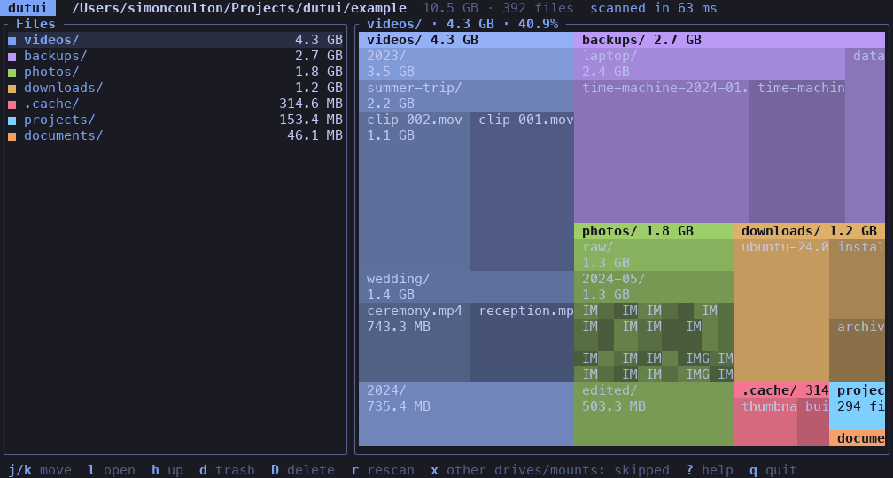

# dutui

A fast terminal disk-usage explorer in the spirit of DaisyDisk. The left pane is the
filesystem; the right pane is a treemap of what is taking up the space.



## Features

- **Treemap view** with nested folders, coloured to match the file list.
- **Fast parallel scanner.** Uses `getattrlistbulk` on macOS, and results appear while
  the scan is still running. Opening a folder mid-scan cancels the scan and scans that
  folder instead.
- **Starts where you launch it**, and you can still navigate above it. Going up scans
  the parent and reuses what is already known.
- **Trash or delete** from inside the app, with confirmation.
- **Themes:** Tokyo Night, Catppuccin (Latte, Frappé, Macchiato, Mocha), Dracula and
  One Dark, with an optional transparent background.
- **Mouse support:** click to select, double-click to open the folder under the
  cursor, right-click to go up, scroll wheel to move.

## Install

```sh
# Homebrew (macOS, Linux)
brew install simoncoulton/dutui/dutui

# Arch Linux (AUR)
yay -S dutui

# Cargo
cargo install dutui
```

Or build from source:

```sh
cargo build --release
./target/release/dutui [PATH]
```

`PATH` defaults to the current directory. Needs Rust 1.89 or newer.

## Keys

| Key | Action |
| --- | --- |
| `j` / `k` | Move selection (also `↑` / `↓`) |
| `l` / `Enter` | Open the selected folder (also `→`) |
| `h` / `Backspace` | Go up a level (also `←`) |
| `g` / `G` | Jump to first / last |
| `d` | Move the selection to the Trash (asks first) |
| `D` | Permanently delete the selection (asks first, folders recursively) |
| `r` | Rescan |
| `t` | Theme picker, with live preview |
| `b` | Toggle transparent background |
| `E` | Edit the config file in `$VISUAL` / `$EDITOR` (reloaded on exit) |
| `u` | Toggle units: GB (decimal) / GiB (binary) |
| `x` | Include / skip other mounted drives and volumes (rescans) |
| `?` | Help |
| `q` / `Esc` | Quit |

## Configuration

Settings are saved to `~/.config/dutui/dutui.yml` whenever you change them:

```yaml
theme: tokyo-night        # tokyo-night, catppuccin-latte, catppuccin-frappe,
                          # catppuccin-macchiato, catppuccin (Mocha), dracula, one-dark
transparent: false        # use the terminal's own background
cross_filesystems: false  # follow other mounted drives and volumes
units: si                 # si (kB, MB, GB) or iec (KiB, MiB, GiB)
```

## Notes

- Sizes are disk usage (allocated blocks), not apparent file size, and hard-linked files
  are counted once. Symlinks are never followed.
- `dutui --bench PATH` scans without the UI and prints the time taken.
- `example/` holds about 10 GB of zero-filled files for trying the app out. Delete it
  with `rm -rf example`.
